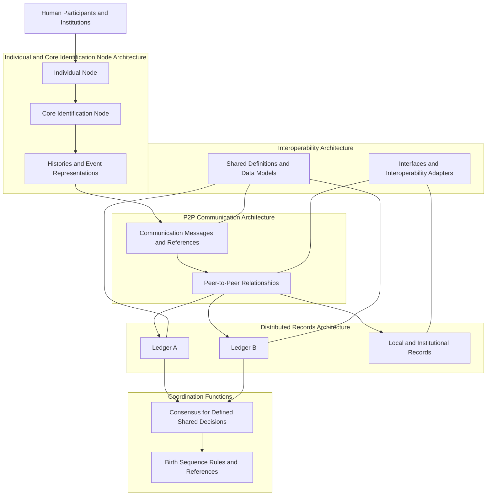

# 9. Civilizational Architecture

## Core Identification Nodes — Civilizational Foundations byLAEV

**Document Classification:** Foundational Architectural Framework  
**Version:** 1.0  
**Status:** Draft

## 9.1. Architectural Purpose and Scope

The civilizational architecture of Core Identification Nodes byLAEV translates the philosophical, theoretical, conceptual, and functional foundations established in Chapters 1–8 into a coherent model of components, responsibilities, relationships, and information flows.

Its central objective is to describe how individual participation, histories, peer-to-peer communication, Ledgers, birth sequencing, consensus, and interoperability may operate as parts of one interconnected ecosystem.

The architecture is organized around the core equation:

**H → P2P → L**

- **H — Histories:** the structured information being communicated.
- **P2P — Peer-to-Peer Communication:** the relationships and mechanisms through which histories are exchanged among participating nodes.
- **L — Ledgers:** the structures through which communicated histories can be recorded and organized.

The equation establishes the central functional relationship. The architecture defines the components and surrounding conditions that allow this relationship to operate.

### 9.1.1. Architectural Objective

The objective is to establish a reference architecture capable of supporting:

1. Individual participation through defined nodes.
2. Organization and reference of individual-related histories.
3. Communication of histories between participating nodes.
4. Recording and organization of histories or references through Ledgers.
5. Coordination of birth-event representations within a defined sequence framework.
6. Distributed agreement for functions that require shared state or ordering.
7. Interoperability between independent systems and institutional environments.
8. Continuity, traceability, and justified correction of records.

These are architectural capabilities to be specified and tested. Their inclusion in this document does not assert that a complete implementation already exists.

### 9.1.2. Architectural Scope

This chapter defines a logical and functional architecture. It does not select a final software stack, network protocol, Ledger technology, consensus algorithm, hosting provider, cryptographic scheme, or institutional governance body.

Those decisions require the later methodological, protocol, governance, and technological chapters.

The architecture must also preserve the distinction between:

- Human beings and their technical representations.
- Human events and the records describing them.
- Network participation and institutional authority.
- Technical recognition and legal recognition.
- A sequence position and a personal identification reference.
- Record integrity and factual accuracy.

### 9.1.3. Architecture as a Complementary Civilizational Layer

Core Identification Nodes byLAEV investigates a complementary architecture that may relate independent participants and record environments.

It does not presume the replacement of national civil-registration systems or the transfer of legal authority to a network.

The United Nations Legal Identity Agenda already advances a holistic and interoperable approach connecting civil registration, vital statistics, and related record-management functions. The World Bank's ID4D guidance likewise emphasizes inclusion, interoperability, and appropriate institutional and data-governance arrangements. These frameworks are relevant existing foundations against which this architecture must be evaluated, not functions that the project can claim to originate.

The proposed contribution examined here is the organization of individual nodes and histories around the functional relationship H → P2P → L, including the possibility of a shared, interoperable birth-event sequence.

**References:** [United Nations Legal Identity Agenda](https://unstats.un.org/legal-identity-agenda/); [World Bank ID4D](https://id4d.worldbank.org/).

## 9.2. Individual Node Architecture

The Individual Node Architecture defines how an individual participant may be represented and connected to the wider network.

It establishes the logical relationship between the human participant, the Individual Node, the Core Identification Node, technical accounts or endpoints, and the histories or records associated with the participant.

### 9.2.1. Human Participant

The human participant is the individual to whom a defined form of participation or a set of related histories may refer.

The participant is not equivalent to the technical node, account, device, or record used to represent participation.

An implementation must specify what evidence or process establishes an association between a participant and a node for the intended purpose. The architecture must not assume that a technical account always corresponds to exactly one human being.

### 9.2.2. Individual Node

The Individual Node is the logical representation of an individual's participation in the network.

It may be associated with:

- One or more technical accounts.
- One or more devices or communication endpoints.
- A Core Identification Node.
- Histories and record references within a defined scope.
- Participation permissions and responsibilities.
- Relevant provenance information.

The exact associations depend on the implementation and governance rules.

### 9.2.3. Core Identification Node

The Core Identification Node is the foundational logical unit through which individual-related histories and references are organized and communicated within the proposed architecture.

Its architectural responsibilities may include:

- Maintaining relationships to one or more Histories.
- Managing references to records maintained by other systems.
- Participating in P2P communication.
- Interacting with one or more Ledgers.
- Presenting the status and provenance of information within its scope.
- Participating in defined consensus or recognition processes when authorized.

The Core Identification Node does not independently establish the legal status of the participant or the truth of every associated record.

### 9.2.4. Technical Representation and Endpoints

A node may be implemented through software, an account, a service, or a combination of technical components.

The architecture must distinguish the logical node from the endpoints through which it operates. An endpoint is a communication interface; it is not necessarily the participant or the full logical node.

Multiple endpoints may be associated with one logical node. One endpoint may also serve multiple defined functions, subject to the relevant authorization and operational rules.

### 9.2.5. Node Identity, Reference, and Association

Each logical node may require a reference within a defined namespace.

The architecture must specify:

- The scope in which the reference is unique.
- How the reference is assigned.
- Whether it can change.
- How associations between nodes and participants are represented.
- How multiple technical representations are related.
- How a node's participation status is maintained.

A node reference must not automatically be treated as a personal identification number, a civil-registration number, or a legal credential.

### 9.2.6. Node Roles

The architecture should support differentiated roles rather than assume that every node performs every function.

Potential roles include:

- Individual participation node.
- Core Identification Node.
- Communication node.
- History source node.
- Record-reference node.
- Ledger-maintaining node.
- Institutional participant node.
- Governance participant node.

These roles are architectural categories for further specification. A single implementation may combine roles, but the authority and responsibilities of each role must remain explicit.

### 9.2.7. Initial GitHub Representation

GitHub may serve as an initial development environment in which accounts represent contributors or operational nodes for repository participation.

Repositories, commits, issues, and other development activities can provide a practical environment for documenting contribution history and evolving the project.

This arrangement is limited to the development context. It does not establish a unique human-to-account relationship, civil registration, a production P2P network, or the final Core Identification Node implementation.

The future architecture must be capable of operating independently of GitHub.

## 9.3. Communication Architecture

The Communication Architecture defines how histories and related information are exchanged among participating nodes.

It implements the P2P dimension of H → P2P → L.

### 9.3.1. Communication Participants

A communication process involves at least:

- A sending node.
- A receiving node or set of receiving nodes.
- A History, record reference, or other defined information object.
- A communication protocol.
- A context that allows the receiving participant to interpret the message.

The participants may operate under different organizational or technical environments.

### 9.3.2. Communication Functions

The architecture may support the following communication functions:

1. **Publication:** making a History or reference available for a defined purpose.
2. **Transmission:** sending information to another participating node.
3. **Reception:** receiving and recognizing the arrival of a message.
4. **Interpretation:** processing information according to shared definitions and formats.
5. **Acknowledgement:** communicating that a message or operation was received or processed to a defined stage.
6. **Reference exchange:** sharing a reference to information maintained by another system.
7. **Status communication:** communicating the status of a History, event representation, or record.
8. **Update communication:** communicating a correction or subsequent change.

These are logical functions. Their message formats and technical operations belong to the P2P protocol specification.

### 9.3.3. Communication Relationship

P2P communication is a relationship between nodes, not simply a property of a network label.

The implementation must specify which communication functions are performed by peers and which are supported by additional services.

A system may use discovery services, relays, gateways, or other infrastructure while retaining peer-to-peer communication for defined functions. The existence of a supporting service does not automatically invalidate the P2P character of the communication model.

### 9.3.4. Message and History Separation

A message is the communication object used to convey information. A History is the structured information or account being communicated.

A message may carry:

- A complete History.
- A defined portion of a History.
- A reference to a History or record.
- An attestation or status statement.
- A notification that an update is available.

The message envelope and the underlying History must remain conceptually distinct.

### 9.3.5. Communication Status

Communication status describes the state of a message or exchange, not the truth of its contents.

Possible communication states may include:

- Prepared.
- Sent.
- Received.
- Acknowledged.
- Rejected at the communication or format level.
- Processing.
- Completed.
- Failed.

These states are candidates for a future protocol vocabulary. They must not be confused with event or registration statuses such as submitted, verified, or legally registered.

### 9.3.6. Communication Boundaries

The architecture must define who may communicate which information, for what purpose, and under what conditions.

The P2P layer must not assume that all histories are public or that all nodes are entitled to receive the same information.

Data exchange must be limited to the information required by the declared function and permitted under applicable rules.

## 9.4. Distributed Records Architecture

The Distributed Records Architecture defines how communicated histories and references may be organized across record-keeping structures maintained by independent participants.

It implements the L dimension of H → P2P → L.

### 9.4.1. Record Structures

The architecture may involve:

- Local records maintained by individual nodes.
- Institutional records maintained by authorized organizations.
- Shared or replicated Ledger entries.
- References to records held elsewhere.
- Indexes that relate records across systems.
- Histories assembled from multiple record sources.

These structures need not be stored in one database or under one operator.

### 9.4.2. Local and Shared Records

A local record remains within the system responsible for maintaining it.

A shared record or Ledger entry is made available to other participants under defined rules.

The architecture should not assume that a shared entry requires replication of the complete underlying record. In many cases, a reference or limited representation may be sufficient for the intended operation.

This distinction allows the system to relate records while preserving the separate responsibilities and information-governance requirements of their sources.

### 9.4.3. Ledger Functions

A Ledger may provide:

- Organization of entries.
- References to Histories or records.
- Ordering according to defined rules.
- Provenance and status information.
- A shared or replicated view of selected records.
- A history of relevant changes.
- A basis for resolving references across participating nodes.

The specific properties depend on the Ledger design. The architecture does not assume that all Ledgers are immutable, public, blockchain-based, or governed by one consensus algorithm.

### 9.4.4. Multiple Ledgers

The plural L in the core equation permits multiple Ledgers.

Different Ledgers may serve different scopes, functions, jurisdictions, or groups of participants.

Where records or references are related across Ledgers, the architecture must define:

- The namespace and reference model.
- Which Ledger is authoritative for which record or function.
- How entries are related.
- How changes are communicated.
- How conflicting states are represented.
- How a receiving node determines the status and source of information.

The architecture must not imply that records from different Ledgers are automatically equivalent or mutually authoritative.

### 9.4.5. Record Continuity and Correction

The records architecture must allow relevant changes to be represented without confusing historical traceability with permanent acceptance of an error.

Depending on the system, this may involve:

- New versions.
- Correction entries.
- Superseding references.
- Dispute statuses.
- Reconciliation relationships.
- Retention or access changes required by applicable rules.

The detailed procedures belong to the later protocol and governance documents.

### 9.4.6. Information Placement

The architecture should define which information belongs in a Ledger, which should remain in a source system, and which can be communicated through references or attestations.

This decision depends on the function, legal basis, sensitivity, availability requirements, and integrity needs of the information.

A shared Ledger should not become a repository for unnecessary personal information merely because the technology allows it.

## 9.5. Birth Sequence Architecture

The Birth Sequence Architecture defines how birth-event representations may be included, ordered, referenced, and related within a shared sequence.

It is a central application of the wider architecture, but it remains a distinct subsystem with its own definitions and rules.

### 9.5.1. Purpose

The purpose is to investigate a framework through which participating nodes and systems can coordinate the sequential accounting of eligible birth-event representations across defined scopes.

The architecture must state what the sequence counts and what each position means.

A sequence may order representations or records according to an agreed rule. It must not claim to count all births worldwide unless coverage and inclusion have been demonstrated.

### 9.5.2. Sequence Object

A sequence entry should refer to a defined birth-event representation, not automatically to a person as a whole.

The conceptual relationship may include:

- Event reference.
- Source or submitting node.
- Reported event time and its precision.
- Submission or registration time.
- Applicable inclusion status.
- Sequence reference or position.
- Provenance and supporting references.
- Correction or dispute relationships.

The final specification must determine which attributes are necessary and which should remain outside the shared sequence.

### 9.5.3. Inclusion Rules

A sequence must define the conditions under which a representation is eligible for inclusion.

Possible dimensions include:

- The event category covered.
- The accepted sources or submission roles.
- The minimum information required.
- The examination or attestation stage required.
- The treatment of incomplete or disputed reports.
- The participation and jurisdictional scope.

Inclusion rules must distinguish a network-level entry from formal civil registration.

### 9.5.4. Ordering Rules

The sequence must define the basis for ordering.

Potential models include:

- Ordering by reported event date.
- Ordering by an authorized registration date.
- Ordering by network receipt or acceptance time.
- Ordering under a defined consensus or coordination procedure.
- A composite method that preserves event time and sequence assignment as separate attributes.

No model should be selected without examining delayed reports, uncertain dates, simultaneous events, corrections, and institutional requirements.

A sequence ordered by receipt time is not necessarily a chronological sequence of births. A sequence ordered by event dates must specify how temporal uncertainty is represented.

### 9.5.5. Sequence Position and Reference

The sequence position is an ordinal within a defined sequence and scope.

It must remain distinct from:

- A local civil-registration number.
- A birth-certificate reference.
- A personal identification reference.
- A Core Identification Node reference.
- A global record reference.

The architecture may relate these references, but it must not treat them as synonyms.

### 9.5.6. Delayed, Corrected, or Disputed Entries

A sequence must define how it handles information received after the event date or after later entries have been assigned.

Possible approaches may include preserving an immutable assignment order while adding event-time metadata, maintaining a revisable event chronology, or using multiple explicitly named sequences for different purposes.

The project has not yet selected one of these approaches. The final design must make the consequences of each option explicit, including the meaning of a sequence position before and after a correction.

### 9.5.7. Coverage and Participation Limits

A sequence must disclose its scope, participating systems, inclusion rules, and coverage limitations.

An incomplete sequence must not be described as a complete global count.

The architecture must also consider how non-participating jurisdictions, unreported births, and records that cannot lawfully or technically be exchanged are represented in aggregate coverage statements.

## 9.6. Consensus Architecture

The Consensus Architecture defines which system functions require agreement among participating nodes and how the relevant agreement is established.

Consensus is not required for every communication or every record operation.

### 9.6.1. Consensus Scope

The architecture must identify the specific decisions for which consensus is required.

Potential uses may include:

- Agreement on a shared Ledger state.
- Acceptance of a sequence entry.
- Ordering of entries under an agreed rule.
- Resolution of competing state updates.
- Adoption of a protocol version.

These operations may require different agreement rules. One consensus mechanism should not be assumed to serve every function.

### 9.6.2. Consensus Participants

The architecture must define who is eligible to participate in each consensus process.

Participants may include technical nodes, institutional nodes, designated validators, or other defined roles.

The system must state whether participation is open, permissioned, institutionally recognized, or organized through a hybrid arrangement. This is a governance and architectural choice, not a property that can be left implicit.

### 9.6.3. Agreement Rules

A consensus process must define:

- The decision being made.
- Eligible participants.
- The method for expressing agreement.
- The threshold or condition for accepting a result.
- The handling of conflicting proposals.
- The point at which a result is final within the system.
- The method for recording the result.

No consensus result should be described as universal agreement outside the defined participant group and scope.

### 9.6.4. Sequence Consensus and Event Verification

Agreement on a sequence entry is not equivalent to verification of the underlying birth event.

The architecture must separate:

- Evidence and procedures concerning the reported event.
- Eligibility for inclusion under sequence rules.
- Agreement about the shared sequence state.
- Legal registration by an authorized civil authority.

A consensus mechanism can coordinate a network state. It cannot independently create legal authority or prove the factual truth of a report.

### 9.6.5. Consensus as a Supporting Architectural Function

Consensus is a supporting component of the wider architecture. The core equation remains H → P2P → L.

The equation does not add consensus as a fourth component because histories may be communicated and records may be organized through processes that do not require collective agreement for every message or action.

Consensus must be introduced where the intended shared-state function requires it.

## 9.7. Global Interoperability Architecture

The Global Interoperability Architecture defines how independent participants, systems, and record environments may exchange and interpret information across institutional, jurisdictional, and technological boundaries.

### 9.7.1. Interoperability Scope

Interoperability must always specify:

- The participating systems.
- The information being exchanged.
- The functions being coordinated.
- The meanings and formats being used.
- The institutional and legal conditions.
- The limitations of the exchange.

A system should not be described as globally interoperable without identifying the scope and participants to which the claim applies.

### 9.7.2. Interoperability Dimensions

The architecture must address:

1. **Connectivity:** systems can establish communication.
2. **Technical compatibility:** interfaces and protocols can exchange information.
3. **Syntactic compatibility:** data structures can be parsed.
4. **Semantic compatibility:** data meanings can be interpreted.
5. **Procedural compatibility:** record status and originating processes can be understood.
6. **Institutional and legal compatibility:** exchange and use occur under applicable authority and agreements.
7. **Operational compatibility:** participants can coordinate the intended functions.

These dimensions are related but not interchangeable.

### 9.7.3. Interoperability Adapters

Independent systems may use adapters or translation components to relate their internal data models to shared network specifications.

An adapter may:

- Map a local event category to a shared term.
- Translate a data structure.
- Resolve a reference.
- Communicate a local record status.
- Preserve source and jurisdictional context.
- Identify information that cannot be represented equivalently.

An adapter must not silently convert different legal or institutional meanings into one false equivalence.

### 9.7.4. Local Autonomy and Shared Standards

Participating systems may retain their internal databases, administrative procedures, and legal responsibilities while adopting common interfaces and definitions for selected exchanges.

This allows interoperability to be pursued without requiring institutional merger or migration to one global database.

### 9.7.5. Institutional Gateways

Some systems may require gateways operated by authorized institutions or service providers.

A gateway may facilitate communication or translate information between environments. Its existence does not automatically make the entire network centralized.

The architecture must identify which functions a gateway performs, which information it can access, and whether it has authority beyond technical communication.

### 9.7.6. International and Cross-Jurisdictional Cooperation

Cross-border interoperability may require agreements, legal bases, or formal participation arrangements.

The network cannot assume that a record lawfully held by one institution can automatically be disclosed or relied upon by another.

The architecture must therefore support the expression of source, jurisdiction, status, and permitted use.

## 9.8. Relational Dynamics Between Individual Nodes and Collective Networks

This section defines how individual participation relates to collective network operation.

### 9.8.1. Individual Participation Within a Collective Architecture

An Individual Node participates within the network through defined relationships and functions.

The network may provide shared communication and record structures, but participation does not require the individual to surrender the distinction between personal histories and the collective systems that relate them.

### 9.8.2. Individual History and Collective Record Organization

An individual-related History may be maintained by a node and communicated to another participant or institution.

A Ledger may record a reference or defined entry concerning that History. Other nodes may relate their own records or histories to the same event, subject, or reference.

The collective record environment is therefore formed through relationships between independently maintained information objects, not necessarily through the creation of one universal personal dossier.

### 9.8.3. Independent Nodes and Shared Infrastructure

Nodes may operate independently while relying on shared protocols and infrastructure for defined functions.

The architecture must specify which resources are shared, which remain local, and which depend on institutional services.

Independence does not imply that nodes are free from shared rules or responsibilities.

### 9.8.4. Network Participation and Institutional Roles

An individual node may communicate information, but formal registration and legal determinations remain with the authorities empowered under applicable law unless a lawful framework establishes otherwise.

The architecture must therefore allow technical participants and institutions to cooperate without collapsing their different roles into one undifferentiated category of node.

### 9.8.5. Collective Coordination Without Erasing Plurality

The network is intended to support cooperation among multiple participants and systems.

It must not assume that every participant shares the same internal structure, authority, culture, or data model. Common protocols should define the minimum conditions needed for the agreed functions.

## 9.9. Integrated Reference Architecture

The following diagram summarizes the logical relationships established in this chapter. It is a reference model, not a deployment diagram or a final technical specification.

### 9.9.1. Reading the Architecture

The diagram identifies the principal logical areas:

- Human participants and institutions engage through defined operational representations.
- Individual Nodes and Core Identification Nodes organize participation and histories.
- Histories and event representations are communicated through P2P relationships.
- Ledgers and other record systems organize entries and references.
- Consensus coordinates only those shared decisions that require agreement.
- Birth Sequence rules define inclusion, ordering, and sequence references.
- Interoperability definitions and adapters relate independent systems.

Governance, legal authority, privacy, and accountability apply across the architecture. They are not represented as one central technical component because they concern the rules and responsibilities governing multiple architectural areas.

### 9.9.2. Architectural Planes

For clarity, the architecture can be described through five interacting planes:

1. **Participation Plane:** individual participants, organizations, Individual Nodes, and Core Identification Nodes.
2. **Information Plane:** Histories, event representations, record references, provenance, and status information.
3. **Communication Plane:** P2P relationships, messages, routing, and supporting services.
4. **Record and Coordination Plane:** Ledgers, shared record states, sequence operations, and defined consensus functions.
5. **Interoperability and Governance Plane:** shared definitions, adapters, participation rules, institutional agreements, and applicable legal requirements.

These planes are analytical views of one architecture. They do not require separate physical infrastructure.

## 9.10. Architecture Boundaries and Design Constraints

The architecture is governed by the following boundaries.

### 9.10.1. No Assumed Replacement of Civil Registration

The architecture is complementary unless a separate lawful agreement or legal framework establishes a different function.

### 9.10.2. No Automatic Equivalence Between Node and Person

A node represents a defined participation or operational role. It is not automatically a unique human being or a legal person.

### 9.10.3. No Automatic Legal Authority From Technical Participation

The ability to communicate, store, validate, or sequence information does not automatically confer civil-registration authority.

### 9.10.4. No Automatic Truth From Record Persistence

A preserved Ledger entry does not independently verify the underlying event.

### 9.10.5. No Assumed Single Ledger

The architecture allows multiple Ledgers and local record systems. Their relationships must be explicitly defined.

### 9.10.6. No Assumed Universal Coverage

Global ambition is not proof of universal participation or complete records. Coverage must be measured and disclosed.

### 9.10.7. No Premature Technology Selection

The architecture defines functions and relationships before selecting specific implementation technologies.

### 9.10.8. Proportionate Information Handling

Information must be communicated, recorded, and retained according to purpose, applicable authority, and data-governance requirements.

## 9.11. Architectural Propositions and Validation Criteria

The following propositions establish what must be demonstrated as the architecture evolves.

### CA-01 — Node Separation

**Proposition:** The architecture can distinguish a human participant, an Individual Node, a Core Identification Node, and the technical endpoints used by the node.

**Validation:** Model cases involving multiple accounts per participant, organization-operated endpoints, and nodes with multiple operational roles.

### CA-02 — History Communication

**Proposition:** Participating nodes can communicate histories or references while preserving the context necessary for interpretation.

**Validation:** Demonstrate message exchange between independent nodes and verify source, purpose, structure, and status interpretation.

### CA-03 — Distributed Record Organization

**Proposition:** Histories or references can be recorded and organized across multiple Ledgers or record systems without requiring one universal database.

**Validation:** Demonstrate cross-system references and determine how source, status, and record authority remain distinguishable.

### CA-04 — Birth Sequence Definition

**Proposition:** The architecture can represent a defined birth sequence with explicit event inclusion, ordering, and reference rules.

**Validation:** Test delayed reports, uncertain dates, simultaneous events, conflicting representations, corrections, and partial participation.

### CA-05 — Consensus Scope

**Proposition:** Consensus functions can be isolated to specific shared decisions rather than required for every communication.

**Validation:** Classify operations by whether they require simple exchange, acknowledgement, examination, or shared-state agreement.

### CA-06 — Interoperability

**Proposition:** Independent systems can relate selected information through common definitions and explicit adapters.

**Validation:** Conduct cross-system tests and document syntactic, semantic, procedural, institutional, and legal limitations.

### CA-07 — Institutional Complementarity

**Proposition:** The architecture can communicate or reference institutional records without assuming or usurping the legal authority of their source institutions.

**Validation:** Analyze representative legal and institutional arrangements and test whether network statuses remain distinguishable from civil-registration statuses.

### CA-08 — Continuity and Correction

**Proposition:** The architecture can preserve relevant record history while representing justified corrections and disputes.

**Validation:** Demonstrate version, correction, supersession, and reconciliation relationships across participating systems.

### CA-09 — Bounded Data Exchange

**Proposition:** The architecture can perform intended functions using complete histories, selected portions, references, or attestations as appropriate.

**Validation:** Compare information exchanged with the stated purpose and demonstrate that unnecessary data is not required for the operation.

### CA-10 — Platform Independence

**Proposition:** The logical architecture can be implemented independently of the initial GitHub development environment.

**Validation:** Define platform-neutral interfaces and demonstrate a separate implementation or a complete implementation plan independent of GitHub-specific functions.

## 9.12. Architectural Decisions Deferred to Later Chapters

The following matters are intentionally not settled here:

1. The formal schema for Individual Nodes and Core Identification Nodes.
2. The precise relationship between a participant, a node, and multiple technical accounts.
3. The P2P transport and discovery protocols.
4. The message envelope and communication state model.
5. The Ledger implementation and record placement strategy.
6. The consensus algorithm and membership model.
7. The Birth Sequence ordering and correction algorithm.
8. The exact interoperability standards and data vocabularies.
9. The governance authority and protocol amendment process.
10. The security, privacy, and data-protection specifications required for a defined implementation.
11. The operational responsibilities of institutional gateways or service providers.
12. The implementation roadmap and measurable acceptance criteria.

These are not omissions in the reference architecture. They are design decisions that require the methods and evidence established in later stages.

## 9.13. Conclusion

The civilizational architecture of Core Identification Nodes byLAEV connects individual participation, histories, peer-to-peer communication, Ledgers, birth sequencing, consensus, and interoperability within one logical framework.

The Individual Node and Core Identification Node architecture provides the participation structure. The Communication Architecture provides the P2P relationships through which histories are exchanged. The Distributed Records Architecture provides structures for recording and organizing those histories. The Birth Sequence Architecture defines how eligible birth-event representations may be included and ordered. The Consensus Architecture coordinates defined shared decisions. The Global Interoperability Architecture relates independent systems, and the relational model explains how individual nodes participate within the wider collective network.

The architecture is intentionally plural: it allows multiple nodes, histories, communication relationships, Ledgers, and institutional environments. It does not assume one global database, one legal authority, or one implementation technology.

Its coherence rests on preserving the distinct responsibilities of each component while defining the relationships required for the intended civilizational functions.

The core equation remains its organizing principle:

**H → P2P → L**

Histories are communicated through peer-to-peer relationships and networks; Ledgers provide the structures through which those histories can be recorded and organized.

**Core Identification Nodes byLAEV — A civilizational architecture connecting individual nodes, histories, communication, and distributed records.**

---

## References

1. United Nations Statistics Division. *United Nations Legal Identity Agenda.* Framework connecting civil registration, vital statistics, and related record-management functions. [https://unstats.un.org/legal-identity-agenda/](https://unstats.un.org/legal-identity-agenda/).
2. World Bank Group. *Identification for Development (ID4D).* Principles and practitioner guidance on inclusive, trusted, and interoperable systems. [https://id4d.worldbank.org/](https://id4d.worldbank.org/).
3. World Bank Group. *Principles on Identification for Sustainable Development: Toward the Digital Age.* [https://id4d.worldbank.org/guide/1-principles](https://id4d.worldbank.org/guide/1-principles).
4. International Organization for Standardization. *ISO 23257:2022 — Blockchain and distributed ledger technologies — Reference architecture.* [https://www.iso.org/standard/75093.html](https://www.iso.org/standard/75093.html).
5. World Wide Web Consortium. *Data on the Web Best Practices.* [https://www.w3.org/TR/dwbp/](https://www.w3.org/TR/dwbp/).
6. World Wide Web Consortium. *PROV-Overview: An Overview of the PROV Family of Documents.* [https://www.w3.org/TR/prov-overview/](https://www.w3.org/TR/prov-overview/).

**Reference note:** These sources provide existing institutional and technical frameworks relevant to the architecture. They do not endorse Core Identification Nodes byLAEV or establish that its proposed global birth-sequence architecture has been validated. The architecture in this chapter is a project reference model and remains subject to formal, institutional, and technical examination.
