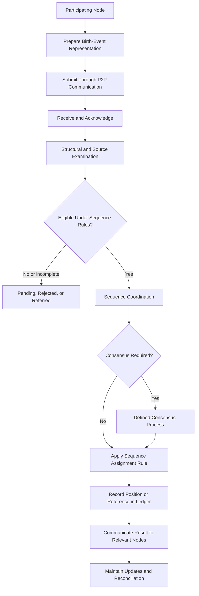

# 11. Protocol Architecture

## Core Identification Nodes — Civilizational Foundations byLAEV

**Document Classification:** Foundational Protocol Framework  
**Version:** 1.0  
**Status:** Draft

## 11.1. Purpose and Scope

This chapter establishes the foundational protocol architecture of Core Identification Nodes byLAEV. It translates the civilizational architecture and methodological foundations into defined operational interactions between participants, nodes, communication mechanisms, record structures, and institutional systems.

The architecture in Chapter 9 describes the principal components and their relationships. This chapter describes how those components are expected to interact through protocols.

A **protocol** is a defined set of rules governing communication, operations, state changes, and expected results between participating entities or systems.

The project's protocol architecture is organized around the following operational areas:

1. Node Onboarding Protocol.
2. P2P Communication Protocol.
3. Human Event Registration Protocol.
4. Birth Sequence Protocol.
5. Consensus Protocol.
6. Interoperability Protocol.
7. Update Protocol.
8. Continuity and Recovery Protocol.
9. Record Reconciliation, Correction, and Discrepancy-Resolution Protocol.
10. Privacy, Disclosure, and Information-Access Protocol.

These are protocol domains. Each may ultimately contain multiple specifications, message types, procedures, and implementation profiles.

This chapter establishes their purpose, participants, principal operations, state relationships, and boundaries. It does not select final transport technologies, cryptographic algorithms, data encodings, consensus algorithms, or jurisdiction-specific legal procedures.

### 11.1.1. Protocol Architecture and the Core Equation

The protocols operationalize the relationship:

**H → P2P → L**

- **H — Histories:** the information being communicated.
- **P2P — Peer-to-Peer Communication:** the communication relationships and mechanisms through which participating nodes exchange histories.
- **L — Ledgers:** the structures through which communicated histories can be recorded and organized.

Protocols define the conditions under which histories are submitted, communicated, interpreted, recorded, updated, and related.

They do not change the meaning of the equation. Nor do they imply that every communication requires a Ledger entry or that every Ledger operation requires a consensus decision.

### 11.1.2. Protocol Boundaries

The protocols must preserve the following distinctions:

- A node account is not automatically proof of one unique human participant.
- A network submission is not automatically a civil registration.
- Receipt of a message is not verification of its contents.
- Network-level acceptance is not automatically legal recognition.
- A sequence position is not automatically a personal identification reference.
- Consensus is agreement under defined network rules, not universal or legal agreement.
- A Ledger entry is not independent proof of the underlying human event.

### 11.1.3. Complementarity With Institutional Procedures

The protocols are intended to support communication and coordination across independent participants and systems.

They do not assume that Core Identification Nodes byLAEV replaces national civil-registration authorities, birth certificates, or other legally established processes. When an operation requires legal authority, the relevant institutional procedure and applicable law remain decisive.

A network protocol may receive a report, preserve a reference, communicate an attestation, or record a network-level status. It must state exactly which of those operations has occurred.

## 11.2. Common Protocol Model

All protocols should share a common conceptual structure so that different operations can be understood and implemented consistently.

### 11.2.1. Protocol Specification Structure

Each protocol specification must identify:

1. **Protocol identifier:** a stable reference within the project protocol namespace.
2. **Name and version:** the protocol's name and applicable version.
3. **Purpose:** the function the protocol is intended to perform.
4. **Scope:** the operations and participants covered.
5. **Roles:** the entities permitted or responsible for each operation.
6. **Preconditions:** the conditions that must be met before an operation begins.
7. **Inputs:** the information required to perform the operation.
8. **Messages and operations:** the defined interactions.
9. **State transitions:** the possible states and the conditions for moving between them.
10. **Outputs:** the expected result of each operation.
11. **Errors and unresolved outcomes:** how failures and incomplete processing are represented.
12. **Authority and boundaries:** which decisions are technical, institutional, or legal.
13. **Data handling:** the information required, its purpose, and applicable access conditions.
14. **Version compatibility:** how implementations identify and negotiate supported versions.
15. **Conformance criteria:** how an implementation demonstrates that it follows the protocol.
16. **References and dependencies:** the concepts, standards, and other protocols on which it relies.

A protocol must not be treated as complete merely because it defines a message format. It must also describe the operation's meaning, state, and expected result.

### 11.2.2. Common Message Envelope

Where a protocol uses message exchange, a common envelope may contain:

- Protocol identifier and version.
- Message identifier.
- Message type or operation.
- Sender node reference.
- Intended recipient or audience scope.
- Creation timestamp.
- Correlation reference for related messages.
- Content type or schema reference.
- Payload or payload reference.
- Relevant provenance or source context.
- Response or acknowledgement expectation, where applicable.

Additional fields may be required by particular protocols. Fields should not be included merely because they are technically available; each must have a defined function.

The message envelope must be distinguishable from the History, event representation, record, or evidence referenced by the message.

### 11.2.3. Operation and Message Identity

A message identifier distinguishes one message from another within a defined namespace.

An operation reference connects messages that belong to the same logical activity, such as a submission followed by an acknowledgement and a later status update.

Where a transport or application may retry an operation, the protocol may define an idempotency reference so that repeated delivery does not unintentionally create duplicate logical outcomes.

The final behavior must be specified per operation. A message identifier alone does not guarantee that an operation has been completed only once.

### 11.2.4. Time Semantics

Messages and records may contain multiple timestamps. Each timestamp must identify the event or operation it represents.

At minimum, protocols should distinguish, where applicable:

- Underlying event time.
- Message creation time.
- Message receipt time.
- Processing time.
- Record creation time.
- Sequence-assignment time.
- Correction or status-change time.

A timestamp generated by a node establishes a value reported by that node under the system's time assumptions. It does not automatically prove the true time of the underlying human event.

### 11.2.5. Acknowledgements and Results

An acknowledgement confirms a defined communication or processing condition.

The protocol must specify whether an acknowledgement means:

- The message was received.
- The message was parsed.
- The operation was accepted for processing.
- The requested operation was completed.
- The resulting record or reference was created.

These meanings must not be collapsed into a generic success response.

### 11.2.6. Error Representation

A protocol must provide a defined way to report invalid input, unsupported versions, missing references, authorization failures, unavailable services, conflicting state, and other operational errors relevant to that protocol.

Where HTTP APIs are used, RFC 9457, *Problem Details for HTTP APIs*, is a relevant standard for machine-readable error descriptions. RFC 9110 defines common HTTP semantics. Their applicability depends on the selected transport and interface design.

Error messages should provide enough information for a participant to understand the failed operation and its next permitted action, without unnecessarily disclosing restricted information.

### 11.2.7. Protocol State Versus Event State

A communication operation has its own state. The event representation or History being communicated has a separate status.

For example:

- A message may be successfully delivered while the event report remains under examination.
- A message may fail to reach a node while the underlying event record remains valid in its source system.
- A network operation may be complete while a civil-registration procedure remains pending.

The protocol architecture must maintain these separate state domains.

## 11.3. Node Onboarding Protocol

The Node Onboarding Protocol establishes how a new participant or operational node becomes part of a defined network environment.

Onboarding concerns participation and operational configuration. It does not automatically establish the legal identity, civil status, or unique human representation of the participant.

### 11.3.1. Purpose

The protocol is intended to:

- Register a node within a defined network namespace.
- Establish its operational reference.
- Record the participant or organization associated with it, when applicable.
- Declare its capabilities and intended roles.
- Establish the applicable protocol versions.
- Record the participation terms and responsibilities.
- Enable the node to begin its permitted operations.

### 11.3.2. Participants and Roles

Possible roles include:

- **Applicant:** the person, organization, or system requesting participation.
- **Onboarding service or process:** the component that receives and processes the onboarding request.
- **Network registrar:** a defined role responsible for maintaining the network's participant or node reference registry, if the architecture uses one.
- **Approving institution or authority:** an entity whose authorization is required for a particular role.
- **Node operator:** the party responsible for operating a technical node.

These roles may be combined in some implementations, but their responsibilities must be explicit.

### 11.3.3. Onboarding Information

An onboarding request may contain:

- Requested node category or role.
- Proposed node reference or requested namespace allocation.
- Technical endpoint information, where needed.
- Supported protocol versions.
- Declared capabilities.
- Operator or organizational information relevant to the role.
- Required participation agreement or authorization reference.
- Initial communication information.

The required information depends on the node's intended function. A basic communication participant should not be required to provide institutional data that is relevant only to an authorized civil-registration role.

### 11.3.4. Onboarding Procedure

The logical procedure is:

1. The applicant submits an onboarding request.
2. The onboarding process checks whether the required fields and declared role are present.
3. The relevant association, authorization, or participation conditions are examined according to the node category.
4. A node reference is assigned or confirmed within the defined namespace.
5. The node receives the applicable protocol and capability information.
6. The node's participation state is recorded.
7. The node performs an initial communication or conformance exchange where required.
8. The node becomes active for the functions it is authorized and technically able to perform.

This is a reference sequence. The exact order and required checks must be specified for each node category.

### 11.3.5. Node States

A candidate node lifecycle may include:

- **Requested:** an onboarding request has been submitted.
- **Under Review:** applicable onboarding conditions are being examined.
- **Approved:** the request has been accepted for the defined role.
- **Active:** the node can perform its permitted operations.
- **Suspended:** one or more operations are temporarily unavailable or restricted under defined rules.
- **Withdrawn:** participation has been ended by the participant or an authorized process.
- **Retired:** the node is no longer operational, while required historical references are retained according to applicable rules.

These states require precise transition conditions in the detailed protocol. A technical state must not be confused with a legal status of the associated human participant.

### 11.3.6. Multiple Representations and Node Associations

A participant may use multiple technical accounts or endpoints. An organization may operate multiple nodes. A node may have more than one operator under defined responsibilities.

The onboarding protocol must provide a way to represent these relationships without assuming a one-to-one correspondence between one person and one account.

### 11.3.7. Onboarding Completion

Successful onboarding means that the node has been registered within the defined network context and enabled for its declared and approved functions.

It does not mean that every associated History has been verified or that the participant has received legal authority beyond the role explicitly established.

## 11.4. P2P Communication Protocol

The P2P Communication Protocol defines how participating nodes exchange Histories, references, notifications, attestations, and status information.

### 11.4.1. Purpose

The protocol implements the communication relationship in H → P2P → L.

It must provide a consistent way to:

- Identify the communicating nodes.
- Identify the operation being requested or performed.
- Carry or reference the information being communicated.
- Receive and interpret messages.
- Acknowledge defined processing stages.
- Report errors and incomplete outcomes.
- Relate messages to subsequent updates or responses.

### 11.4.2. Communication Operations

The initial logical operation set may include:

- **PUBLISH:** make a History or reference available under defined terms.
- **SEND:** transmit a message to a node or group.
- **REQUEST:** ask a node for a permitted History, reference, or status.
- **RESPONSE:** return the requested information or result.
- **ACKNOWLEDGE:** confirm a defined receipt or processing stage.
- **NOTIFY:** communicate a relevant event or record status change.
- **UPDATE:** communicate a subsequent version or change.
- **WITHDRAW:** communicate that a previously available representation is no longer offered or should be treated under a defined changed status.

These names establish conceptual operations. Their final wire-level identifiers and message formats belong to a later technical specification.

### 11.4.3. Communication Procedure

A typical communication interaction may follow:

1. The sending node selects the intended operation.
2. It identifies the recipient or recipient scope.
3. It prepares the message envelope and the History, payload, or reference.
4. It transmits the message through the selected communication mechanism.
5. The receiving node determines whether the message can be interpreted under the stated protocol version.
6. The receiver returns the acknowledgement or response defined for the operation.
7. The sender records the result and, where necessary, continues with a related operation.

A message receipt must not be interpreted as acceptance of the content unless the protocol expressly defines that result.

### 11.4.4. Delivery and Retry Semantics

Each operation must define what delivery behavior it requires.

For example, a notification may tolerate delayed delivery, while an operation that requests a sequence assignment may require an explicit final result.

Where retries are supported, the protocol should define how duplicate messages and repeated requests are recognized and handled. The system must specify whether the operation is idempotent, whether a repeated request returns a prior result, or whether it creates a new operation.

The protocol should not claim exactly-once processing unless the implementation and its operating assumptions can substantiate that guarantee.

### 11.4.5. Direct, Relayed, and Hybrid Communication

The protocol must remain independent of a single transport topology.

A message may be delivered directly between peers or through a relay, gateway, or other supporting service. The communication record should identify the logical sender and intended recipient even where infrastructure intermediaries are involved.

The detailed architecture must define which intermediary functions are permitted and whether they can access message content or only routing information.

### 11.4.6. Communication Outcomes

Possible outcomes include:

- Delivered and acknowledged.
- Received but not yet processed.
- Accepted for processing.
- Completed.
- Rejected due to a defined protocol condition.
- Temporarily unavailable.
- Failed.
- Outcome unknown because the response was not received.

An unknown outcome must not automatically be treated as failure or success. The protocol must define how the sender can determine the operation's actual state.

## 11.5. Human Event Registration Protocol

For this project, the term **Human Event Registration Protocol** refers to the network-level submission and recording of an event representation within the Core Identification Nodes architecture.

It does not mean that a participating node or Ledger automatically performs civil registration under national law.

### 11.5.1. Purpose

The protocol defines how information concerning a Human Event can be submitted, associated with a source, examined within a stated scope, assigned a network status, and recorded or referenced.

It is intended to make event representations interpretable and traceable across participating nodes.

### 11.5.2. Event Submission

A submission may include:

- Event category.
- Reported event time and its precision.
- Relevant contextual attributes.
- Submitting node reference.
- Source or authority reference, where applicable.
- Supporting evidence or attestation references, where available and lawfully shareable.
- Intended processing purpose.
- Relevant History or record references.

The required attributes must be determined by the event category and intended function. The protocol should not require personal information that is not necessary for that function.

### 11.5.3. Registration Procedure

The logical procedure may include:

1. A participating node prepares an event representation.
2. The node submits the representation or an authorized reference to the registration process.
3. The receiving process acknowledges receipt.
4. The submission is examined for structural completeness and protocol compatibility.
5. The source and declared status are associated with the representation.
6. Any additional examination required for the intended network status is performed by the role authorized to perform it.
7. The process returns a defined outcome.
8. Where the operation requires persistence, the record or reference is incorporated into the relevant record structure or Ledger.
9. The submitting node receives a result reference and status.

The procedure must identify which steps are technical checks and which constitute an evidentiary, institutional, or legal examination.

### 11.5.4. Network Event Status

A project-level event status vocabulary may include:

- **Submitted:** information has been transmitted by a participating node.
- **Received:** the receiving system has acknowledged the submission.
- **Structurally Accepted:** the information satisfies the applicable message and data-structure requirements.
- **Under Examination:** a defined review or verification process is in progress.
- **Source-Attested:** a source or authorized participant has provided an attestation within its declared authority.
- **Network-Recorded:** a representation or reference has been recorded under the network's rules.
- **Disputed:** a relevant participant has raised a defined discrepancy or challenge.
- **Corrected:** a subsequent representation has been associated with a documented correction.
- **Superseded:** a later representation has replaced the current operational reference under defined rules.

These states are not equivalent to civil registration statuses. The final status vocabulary must define permitted transitions and the evidence or authority required for each state.

### 11.5.5. Institutional Record References

Where an event has been registered by a competent institution, the protocol may communicate a reference or attestation concerning that record, subject to the relevant authorization and legal basis.

The network must preserve the distinction between:

- An event report submitted by a node.
- A network-level event representation.
- An attestation from a source or institution.
- A civil-registration record maintained by an authorized authority.

A network record must not claim to replace or reproduce the legal effect of the source institutional record.

### 11.5.6. Registration Result

The protocol should return:

- The operation reference.
- The event representation reference, where assigned.
- The resulting network status.
- The relevant source and provenance references.
- Any examination or follow-up requirement.
- The applicable protocol version.
- A clear explanation where the request was not completed.

The result should identify what the process actually accomplished and what it did not establish.

## 11.6. Birth Sequence Protocol

The Birth Sequence Protocol defines the operations through which eligible birth-event representations may be proposed, examined, included, ordered, referenced, and later corrected within a defined sequence.

### 11.6.1. Purpose

The protocol operationalizes a shared sequence model while preserving the distinction between the underlying birth event, the event representation, a civil-registration record, and the sequence position.

### 11.6.2. Sequence Definition

Before sequence operations can be performed, the sequence specification must define:

- Sequence scope and purpose.
- Eligible event category.
- Inclusion criteria.
- Required source or examination conditions.
- Ordering rule.
- Sequence namespace.
- Assignment procedure.
- Treatment of uncertain or equal event times.
- Rules for delayed reports and corrections.
- Participation and coverage limitations.

A protocol implementation must identify the sequence definition and version under which it operates.

### 11.6.3. Sequence Operations

The initial logical operation set may include:

- **PROPOSE_ENTRY:** submit a birth-event representation for sequence consideration.
- **CHECK_ELIGIBILITY:** determine whether the representation satisfies the inclusion conditions.
- **ASSIGN_POSITION:** assign a position under the defined ordering and coordination rules.
- **RECORD_POSITION:** record the sequence reference and relevant provenance.
- **QUERY_POSITION:** request the status or position associated with an event representation.
- **REPORT_DISCREPANCY:** communicate a conflict or uncertainty affecting an entry.
- **CORRECT_ENTRY:** associate a justified correction with a prior representation.
- **SUPERSEDE_ENTRY:** indicate that a later entry or state replaces the operational status of a previous one under defined rules.

The exact operation set may be revised when the formal sequence model is approved.

### 11.6.4. Sequence Assignment Procedure

A possible logical procedure is:

1. A node submits a birth-event representation for sequence consideration.
2. The system identifies the applicable sequence definition and version.
3. The representation is checked against the inclusion requirements.
4. Missing, uncertain, or conflicting information is assigned a defined pending or disputed status.
5. An eligible representation proceeds to the ordering and assignment process.
6. The sequence procedure determines a position under the approved ordering rule.
7. The assignment result is recorded with its event reference, sequence reference, rule version, and assignment context.
8. Participating nodes receive the result or a reference to it.

This procedure does not select the final ordering algorithm. That decision must be formalized and tested against the requirements identified in Chapters 3, 7, 8, and 9.

### 11.6.5. Event Time and Assignment Time

Every implementation must preserve the distinction between:

- Reported or established birth-event time.
- Submission time.
- Examination or registration time.
- Sequence-assignment time.
- The resulting sequence position.

If a sequence is ordered by event time, its rules must describe how uncertainty, delayed reporting, and corrected dates affect the order. If a sequence is ordered by registration or acceptance time, it must not be described as a strict chronological order of births.

### 11.6.6. Delayed and Corrected Reports

The protocol must define how a report received after later positions have already been assigned is handled.

Possible designs include maintaining an append-only assignment history, assigning a later position while retaining event-time metadata, or using a formally defined method for revising sequence order.

No one approach is selected in this chapter. The final design must specify the meaning of previously issued positions and the consequences of a correction.

### 11.6.7. Sequence Result

A sequence result should identify:

- The sequence definition and version.
- The event representation reference.
- The assigned position, if one was assigned.
- The assignment time.
- The ordering rule or rule reference.
- The status of the entry.
- The relevant provenance and correction references.
- The limitations of the sequence scope.

The result must not imply universal coverage or legal registration beyond what has been established.

## 11.7. Consensus Protocol

The Consensus Protocol defines how eligible participants coordinate specific decisions or shared states when the architecture requires agreement.

### 11.7.1. Purpose

The protocol may support agreement concerning:

- Acceptance of a Ledger state.
- Ordering of shared entries.
- Sequence assignment.
- Resolution of competing updates.
- Protocol version activation.
- Other explicitly defined shared decisions.

Consensus is not required for every message or submission.

### 11.7.2. Consensus Domain

Each consensus operation must define:

- The subject of agreement.
- The participants eligible to take part.
- The proposed value, state, or decision.
- The agreement rule.
- The conditions for finality within the system.
- The process for recording the outcome.
- The treatment of disagreement or non-participation.

A consensus result must always be described within this domain.

### 11.7.3. Consensus Procedure

A generic consensus process may consist of:

1. **Proposal:** an eligible participant submits a proposal.
2. **Distribution:** the proposal is communicated to the participants required by the protocol.
3. **Evaluation:** participants examine the proposal according to defined rules.
4. **Response:** participants submit the responses or votes permitted by the process.
5. **Decision:** the protocol determines whether the acceptance condition has been met.
6. **Finalization:** the resulting state or decision is recorded.
7. **Notification:** relevant participants receive the outcome.

This is a logical structure, not a selected algorithm. Different consensus models may require different message sequences and failure handling.

### 11.7.4. Membership and Participation

The consensus protocol must define whether participants are known and admitted, open to join, selected by institutional role, or organized through a hybrid model.

Membership requirements must be consistent with the purpose of the decision. A consensus process used for a technical Ledger operation must not be treated as a universal political or legal decision-making body.

### 11.7.5. Consensus Outcomes

Possible outcomes include:

- Accepted.
- Rejected.
- Pending.
- Inconclusive.
- Conflicting proposals detected.
- Timed out under the protocol's defined conditions.

The protocol must specify what each outcome permits next.

### 11.7.6. Separation From Event Examination

Consensus may establish that an entry meets the network's inclusion and ordering rules. It does not by itself establish that the reported birth occurred or that the report has legal effect.

Where event examination or institutional registration is required, the appropriate process must remain separate and its result must be represented distinctly.

## 11.8. Interoperability Protocol

The Interoperability Protocol defines how independent systems exchange information and interpret it under common specifications.

### 11.8.1. Purpose

The protocol aims to support structured information exchange without requiring participants to abandon their internal data models, administrative procedures, or institutional responsibilities.

### 11.8.2. Interoperability Profiles

Each exchange should identify an applicable profile specifying:

- Supported information types.
- Data schemas and versions.
- Shared vocabulary or terminology.
- Reference and namespace rules.
- Status mappings.
- Permitted operations.
- Required provenance context.
- Exchange permissions and intended purpose.
- Error and incompatibility handling.

A profile defines a specific interoperability scope. It does not make two systems universally interoperable.

### 11.8.3. Mapping Procedure

When a system exchanges information with another system:

1. The source system identifies the information and source context.
2. The applicable interoperability profile is identified.
3. The source representation is mapped to the agreed exchange structure.
4. Any non-equivalent or unsupported information is identified.
5. The message is transmitted.
6. The receiving system parses the structure.
7. The receiver maps shared elements into its local model where appropriate.
8. The receiver preserves source and status context.
9. The receiving system returns the defined result.

Mappings must not conceal semantic or legal differences.

### 11.8.4. Reference Resolution

Where a message contains a reference rather than the underlying record, the protocol must define:

- The reference namespace.
- The system or authority responsible for resolution.
- The conditions for access.
- The expected response.
- The behavior when a reference cannot be resolved.
- The treatment of changed or superseded references.

A reference must not be assumed to be globally resolvable merely because it is syntactically valid.

### 11.8.5. Version Compatibility

Each interoperability profile must define supported versions and permitted compatibility behavior.

A receiving system should be able to determine whether it can interpret the incoming representation. Unsupported or ambiguous fields must be handled explicitly rather than silently discarded where they are material to the operation.

### 11.8.6. Conformance Testing

A system should be tested against the profile's requirements, including syntax, semantics, status mapping, provenance, reference handling, and operational results.

Conformance to a data schema alone does not demonstrate full interoperability.

### 11.8.7. Institutional and Legal Conditions

Technical compatibility does not automatically create a legal basis for data exchange or use.

Where information is exchanged between institutions or jurisdictions, the protocol must identify the applicable agreement, authority, purpose, and restrictions relevant to the operation.

## 11.9. Update Protocol

The Update Protocol governs changes to histories, records, references, and protocol-controlled objects after their initial creation or registration.

It must distinguish updates to information objects from updates to the protocol rules themselves.

### 11.9.1. Types of Update

The protocol should distinguish:

- **Content update:** a change to the content of a History or record.
- **Metadata update:** a change to attributes such as classification or context.
- **Reference update:** a change to a pointer or relationship between records.
- **Status update:** a change in the procedural state of an object.
- **Correction:** a change intended to remedy an identified error.
- **Protocol update:** a change to the rules governing operations.
- **Software update:** a change to an implementation.

These changes must not be handled as if they were one operation.

### 11.9.2. Update Request

An update request may include:

- The target object reference.
- The requested operation.
- The proposed new content or status.
- The source and reason for the update.
- Supporting references where required.
- The applicable rule or authority.
- The expected version or prior state.

The exact fields depend on the update type.

### 11.9.3. Update Procedure

A generic update procedure may include:

1. Identify the target object and its current version or state.
2. Submit the requested change.
3. Determine whether the submitter is permitted to request that change.
4. Examine required preconditions and supporting information.
5. Apply the change or return a defined rejection or pending state.
6. Preserve the relevant relationship to the prior state.
7. Communicate the resulting version and status to affected participants.
8. Update dependent references or records where required by the protocol.

The process must identify which system is authoritative for the object being changed. A network node must not silently modify a record controlled by an external institution.

### 11.9.4. Concurrent Updates

Where more than one participant may update the same object, the protocol must define how concurrent changes are detected and resolved.

Possible methods include version references, conditional updates, append-only correction entries, or a defined reconciliation process.

The selected method must follow the record model and use case. The protocol must not assume that last-write-wins is appropriate for every History or record.

### 11.9.5. Update Result

An update result should identify the target object, resulting version or status, operation reference, responsible source, and any unresolved dependency.

A rejected or incomplete update must not be represented as though the underlying object had changed.

## 11.10. Continuity and Recovery Protocol

The Continuity and Recovery Protocol defines how participating nodes and record structures resume their intended functions after interruption, replacement, or loss of operational state.

### 11.10.1. Purpose

Continuity concerns the ability to maintain or restore the relevant history and operational state of a node or Ledger.

Recovery concerns the process of re-establishing a defined state after an interruption or loss.

The protocol is concerned with restoring the intended function and preserving the required record relationships. It does not assume that every system must provide identical recovery guarantees.

### 11.10.2. Recovery Scenarios

A recovery procedure may be required when:

- A node restarts after an ordinary interruption.
- A node has been offline while other participants continued operating.
- A local record store is restored from a backup.
- A node is replaced by a new technical instance.
- A Ledger replica must resynchronize.
- A participant changes its endpoint or operational environment.
- A protocol version is restored or migrated.

The required behavior depends on the affected component and the importance of the records it maintains.

### 11.10.3. Continuity Information

To resume operation, a node may need:

- Its logical node reference.
- Current protocol versions.
- Relevant record references.
- Last known operational state.
- Ledger or replication checkpoints, where applicable.
- Pending communication operations.
- Known update and correction relationships.
- Required participation or authorization state.

The minimum information must be defined for each component and retained according to its purpose and applicable rules.

### 11.10.4. Recovery Procedure

A generic recovery procedure may include:

1. Identify the component and scope affected by the interruption.
2. Determine the last known usable state.
3. Restore or reconstruct the relevant local information.
4. Re-establish permitted communication relationships.
5. Retrieve or reconcile updates received while the component was offline.
6. Resolve incomplete operations and duplicate messages.
7. Verify the consistency of the restored state under the relevant protocol.
8. Resume normal operation and record the recovery result.

### 11.10.5. Recovery and Record Authority

Restoring a local copy does not automatically make it the authoritative version of a record.

Where multiple systems maintain related information, the recovery process must identify the source of authority for each object or status.

The protocol must preserve distinctions between locally maintained data, shared Ledger state, and records controlled by an external institution.

### 11.10.6. Recovery Result

A recovery result should describe:

- The component restored.
- The recovery point or state used.
- Any data or operations not recovered.
- Any reconciliation still required.
- The status of communication and Ledger synchronization.
- The time at which normal operations resumed.

The protocol must not report complete recovery when unresolved records or dependencies remain.

## 11.11. Record Reconciliation, Correction, and Discrepancy Resolution Protocol

This protocol defines how participants identify, represent, examine, and resolve differences between related records or histories.

### 11.11.1. Purpose

Reconciliation is required because independent systems may contain different information concerning related events.

Differences may arise from delayed reporting, different scopes, separate updates, conflicting sources, incomplete data, or errors.

The protocol must preserve the fact that a discrepancy exists until the relevant process has produced a defined result.

### 11.11.2. Discrepancy Categories

A discrepancy may concern:

- Different values for the same attribute.
- Different reported dates or temporal precision.
- Different references to related records.
- Conflicting source statements.
- Different procedural or legal statuses.
- Duplicate event representations.
- Missing information.
- A correction made by one source but not yet reflected elsewhere.
- An incompatible interpretation between systems.

The category determines the appropriate reconciliation process.

### 11.11.3. Reconciliation Procedure

A generic reconciliation process may include:

1. Identify the affected records or histories.
2. Establish the scope and category of the discrepancy.
3. Preserve the source and status of each representation.
4. Determine which participants or authorities are responsible for the affected information.
5. Request additional information or an authoritative source correction where appropriate.
6. Examine the available evidence according to the relevant rules.
7. Record the reconciliation outcome or the fact that the discrepancy remains unresolved.
8. Communicate the result to affected nodes.
9. Update related references or statuses where authorized.
10. Preserve the relevant history of the reconciliation operation.

### 11.11.4. Correction and Source Authority

A correction to a network record and a correction to an institutional source record are different operations.

A network may record that a source has issued a correction or that a prior representation has been superseded. It must not claim to alter an external civil-register entry unless the source institution or a legally authorized process performs that operation.

Where the source is authoritative for a particular record, the network should preserve that source relationship and reflect the status of the correction without substituting its own authority.

### 11.11.5. Dispute Status

If a discrepancy cannot be resolved under the applicable procedure, the protocol should retain a dispute or unresolved status.

The existence of disagreement should not be concealed by automatically selecting one record, deleting another, or declaring a universal result without an applicable decision process.

### 11.11.6. Reconciliation Outcomes

Possible outcomes include:

- Confirmed equivalent records.
- Duplicate representation identified.
- Correction accepted by the relevant source.
- Network representation updated.
- One record superseded.
- Discrepancy resolved under a defined authority.
- Discrepancy remains open.
- Referral to an institution or procedure outside the network.

The protocol must state what each outcome means and which participant or authority is responsible for it.

## 11.12. Privacy, Disclosure, and Information-Access Protocol

This protocol defines how information is classified, accessed, communicated, disclosed, retained, and restricted within the architecture.

Privacy and information access are not separate from protocol functionality. They determine which participants may perform which information operations and for what purposes.

### 11.12.1. Purpose Limitation

Each information operation must have a defined purpose.

The protocol should establish why the information is required, which function it supports, and which participants are entitled to receive it.

Information should not be collected or disclosed merely because it can be transmitted or stored.

### 11.12.2. Data Minimization

The information required for one operation may be less than the complete History or record.

The protocol should support the exchange of:

- A complete History where necessary and authorized.
- A selected portion of a History.
- A record reference.
- A status or acknowledgement.
- An attestation or proof appropriate to the use case.

The least extensive information object that satisfies the defined function should be considered first, subject to the relevant evidentiary and operational requirements.

### 11.12.3. Information Categories

The architecture may distinguish information by access and disclosure requirements, for example:

- Public project documentation.
- Public technical specifications.
- Network operational metadata.
- Participant-controlled information.
- Restricted or institutionally controlled records.
- Sensitive personal information.
- Information subject to specific legal or retention requirements.

The final classification model must be established through governance and applicable legal analysis. This list is a working classification, not a universal legal taxonomy.

### 11.12.4. Access Decision

An access decision should identify:

- The information requested.
- The requesting participant or role.
- The stated purpose.
- The applicable access rule or authority.
- The scope of information to be disclosed.
- Any restrictions or conditions.
- The result and relevant record of the decision.

Access may be granted, denied, limited, referred for additional authorization, or left pending.

### 11.12.5. Disclosure Procedure

A disclosure procedure may include:

1. A participant submits a request identifying the information and purpose.
2. The receiving system determines which authority or rule governs the information.
3. The request is evaluated under the applicable access conditions.
4. The minimum information necessary for the approved purpose is identified.
5. The information or reference is disclosed, or the request is denied or referred.
6. The decision and any relevant disclosure metadata are recorded according to applicable rules.

The protocol must not assume that the node holding a copy or reference is automatically authorized to disclose the underlying source information.

### 11.12.6. Consent and Other Legal Bases

Consent may be relevant for some information operations, but it is not automatically the only lawful basis for processing information.

The applicable legal basis depends on the jurisdiction, institutional role, purpose, and category of information.

The protocol must allow the relevant authority or lawful basis to be identified without inventing a universal consent rule.

### 11.12.7. Disclosure and Ledger Design

The presence of information in a Ledger does not mean it must be publicly readable.

Ledger architecture, access controls, reference design, and information placement must be selected consistently with the intended purpose and applicable requirements.

A Ledger may hold a limited reference or status while underlying information remains with an authorized source.

### 11.12.8. Retention, Restriction, and Deletion

The protocol must distinguish:

- Retention of a record.
- Restriction of access.
- Correction of content.
- Supersession by a later record.
- Deletion or disposal under applicable rules.
- Preservation of a minimal audit or provenance record where lawfully permitted and necessary.

These operations have different meanings and consequences. The final rules must be determined through the applicable governance and legal processes.

### 11.12.9. Access and Disclosure Accountability

Where appropriate and lawful, the system should maintain records of significant access and disclosure decisions, including the requester or role, purpose, result, and information scope.

Such records support accountability but must themselves be subject to appropriate information minimization and access rules.

## 11.13. Protocol Conformance and Operational Testing

A protocol is useful only if independent implementations can understand and apply its rules consistently.

### 11.13.1. Conformance Requirements

Each protocol specification should define:

- Required operations.
- Supported message types.
- Required and optional fields.
- State transitions.
- Expected responses.
- Error behavior.
- Version compatibility.
- Role and permission requirements.
- Required record and provenance outcomes.

### 11.13.2. Conformance Testing

Tests should examine whether an implementation:

1. Produces messages in the defined structure.
2. Interprets supported messages correctly.
3. Enforces the defined operation preconditions.
4. Produces the expected state transitions.
5. Returns the defined acknowledgement or result.
6. Handles unsupported versions and invalid inputs as specified.
7. Preserves source, status, and reference relationships.
8. Distinguishes technical outcomes from institutional or legal outcomes.

### 11.13.3. Interoperability Testing

At least two independent implementations should be used where the protocol claims interoperability.

A single implementation that communicates with itself does not demonstrate cross-implementation compatibility.

The test should document versions, configuration, test data, operations, expected results, observed results, and limitations.

### 11.13.4. Protocol Status

A protocol may move through the following project documentation states:

- **DRAFT:** being defined and examined.
- **REVIEW:** subject to formal, technical, or institutional examination.
- **APPROVED:** accepted as a project reference for a defined version and scope.
- **DEPRECATED:** retained for historical reference but no longer recommended for new implementations.
- **RETIRED:** no longer supported for operational use.

Approval does not mean universal adoption or legal recognition.

## 11.14. Protocol Lifecycle and Evolution

Protocols must evolve without leaving participants unable to interpret previous messages or records.

### 11.14.1. Protocol Versioning

Each protocol must have a stable identifier and version.

A version change must identify:

- The reason for change.
- The affected operations and message structures.
- Compatibility with previous versions.
- Required changes for implementations.
- The treatment of messages or records created under previous versions.
- The transition or deprecation period, where applicable.

### 11.14.2. Protocol Amendment

A protocol amendment should be supported by:

- A documented problem or requirement.
- A proposed change.
- Impact analysis.
- Review and validation results.
- An approval decision under project governance.
- Updated conformance tests and documentation.

### 11.14.3. Backward Compatibility

Where backward compatibility is required, the protocol must define which earlier versions remain supported and how differences are handled.

Compatibility must not be assumed merely because a new implementation can parse an earlier message. The meaning and behavior must also remain compatible for the operations in scope.

### 11.14.4. Protocol Registry

The project should maintain a protocol registry containing:

- Protocol identifier.
- Name and purpose.
- Current version.
- Status.
- Applicable scope.
- Dependencies.
- Conformance requirements.
- Change history.
- Links to the authoritative specification.

The registry may be maintained in the project repository during initial development.

## 11.15. Integrated Protocol Relationship

The ten protocol domains form an operational system.

- Node Onboarding establishes participation and operational roles.
- P2P Communication exchanges histories and related information.
- Human Event Registration records network-level representations and statuses.
- Birth Sequence coordinates inclusion and ordering for eligible birth-event representations.
- Consensus coordinates specified shared decisions.
- Interoperability relates independent systems and meanings.
- Update manages changes to information objects and references.
- Continuity and Recovery restores defined operational and record states.
- Reconciliation handles discrepancies and justified corrections.
- Privacy, Disclosure, and Information Access governs permitted information operations.

They are connected but not required to execute as one universal linear workflow.

For example, a node may be onboarded and exchange a History without creating a Birth Sequence entry. A record may be updated without requiring a new onboarding operation. A Ledger may be queried without a new consensus decision. A discrepancy may be opened while other unrelated operations continue.

The architecture must define dependencies only where a function requires them.

### 11.15.1. Illustrative Birth-Event Protocol Flow

The following diagram illustrates one possible relationship between protocols. It is not a final sequence algorithm or a legal registration procedure.

The diagram separates message receipt, examination, sequence eligibility, consensus where required, Ledger recording, and subsequent update or reconciliation. It does not imply that the network performs legal civil registration.

## 11.16. Protocol Requirements and Validation Criteria

### PA-01 — Defined Roles

Each protocol operation must identify the roles permitted to perform it.

**Validation:** Test operations with participants assigned different roles and verify that the resulting behavior corresponds to the role definitions.

### PA-02 — Explicit Operation Meaning

Each message and operation must have a defined purpose and expected result.

**Validation:** Independent implementers can interpret the operation consistently from the specification.

### PA-03 — Separate State Domains

Communication, event, record, sequence, and legal statuses must remain distinguishable.

**Validation:** Test cases in which one state changes while another remains pending or unchanged.

### PA-04 — Provenance Preservation

Protocol operations must preserve sufficient information to identify the source and context of relevant representations.

**Validation:** A receiving implementation can identify the declared source and relevant processing history within the specified scope.

### PA-05 — Defined Sequence Semantics

Birth Sequence operations must refer to a versioned sequence definition and explicit inclusion and ordering rules.

**Validation:** Test delayed, uncertain, simultaneous, disputed, and corrected event representations.

### PA-06 — Scoped Consensus

Consensus must be used only for operations that require an agreed shared state or decision.

**Validation:** Demonstrate ordinary communication operations that do not depend on consensus and define the exact operations that do.

### PA-07 — Interoperability Conformance

Independent systems must be able to exchange and interpret the defined information under an applicable profile.

**Validation:** Complete cross-implementation tests with documented results and limitations.

### PA-08 — Update Traceability

Updates and corrections must be related to the relevant prior state and authorized source.

**Validation:** Demonstrate that the current state and relevant change history can be interpreted without conflating the two.

### PA-09 — Continuity and Recovery

A recovery process must identify what has and has not been restored.

**Validation:** Test interruption and restoration scenarios and document incomplete operations and unresolved dependencies.

### PA-10 — Proportionate Information Access

Access and disclosure operations must be purpose-based and limited to the information required under applicable rules.

**Validation:** Test authorized, restricted, denied, and partial-disclosure cases with appropriate information-handling records.

## 11.17. Matters Deferred to Detailed Protocol Specifications

This chapter establishes the protocol architecture, but the following items require dedicated specifications before implementation:

1. Canonical message schema and encoding.
2. Node reference and namespace allocation.
3. Node onboarding evidence and authorization requirements by role.
4. P2P discovery, addressing, transport, and delivery semantics.
5. Event representation schema and status vocabulary.
6. Birth Sequence inclusion and ordering algorithm.
7. Sequence namespace and position-allocation procedure.
8. Consensus membership and algorithm.
9. Interoperability profiles and mapping registries.
10. Update concurrency and version-conflict handling.
11. Recovery checkpoints and synchronization procedure.
12. Reconciliation authority and case-management process.
13. Privacy classification, access rules, and applicable legal bases.
14. Protocol conformance test suite.
15. Protocol registry and amendment governance.

These decisions must be made from the defined use cases and requirements. They should not be invented in advance of the problems they are intended to solve.

## 11.18. Conclusion

The Protocol Architecture of Core Identification Nodes byLAEV defines how participants and systems are expected to interact through ten protocol domains: onboarding, P2P communication, event registration, birth sequencing, consensus, interoperability, updates, continuity and recovery, reconciliation, and information access.

The protocols give operational form to the civilizational architecture while preserving the distinctions established in the foundational chapters.

They establish that a network submission is not automatically a civil registration, communication is not acceptance, consensus is not legal authority, and a Ledger entry does not independently prove the underlying event.

The protocol model remains deliberately implementation-neutral. It defines the interactions, roles, states, and expected outcomes that later specifications must make precise. Detailed message schemas, algorithms, transport choices, consensus mechanisms, and jurisdiction-specific procedures remain subject to formal requirements, technical testing, and applicable institutional or legal analysis.

The governing relationship remains:

**H → P2P → L**

Histories are communicated through peer-to-peer relationships and networks; Ledgers provide the structures through which those histories can be recorded and organized.

**Core Identification Nodes byLAEV — Defined protocols for communicating histories, coordinating records, and connecting independent nodes.**

---

## References

1. World Wide Web Consortium (W3C). *Verifiable Credentials Data Model v2.0.* W3C Recommendation, 15 May 2025. [https://www.w3.org/TR/vc-data-model/](https://www.w3.org/TR/vc-data-model/).
2. World Wide Web Consortium (W3C). *Decentralized Identifiers (DIDs) v1.0.* W3C Recommendation, 19 July 2022. [https://www.w3.org/TR/did-core/](https://www.w3.org/TR/did-core/). The later DID v1.1 work was published as a Candidate Recommendation Snapshot on 5 March 2026; it should be treated according to its publication status. [DID v1.1 status](https://www.w3.org/TR/did-1.1/).
3. Fielding, Roy T., Mark Nottingham, and Julian Reschke, eds. *RFC 9110: HTTP Semantics.* Internet Standards Track, June 2022. [https://www.rfc-editor.org/rfc/rfc9110.html](https://www.rfc-editor.org/rfc/rfc9110.html).
4. Nottingham, Mark, Erik Wilde, and Sanjay Dalal. *RFC 9457: Problem Details for HTTP APIs.* Internet Standards Track, July 2023. [https://www.rfc-editor.org/rfc/rfc9457.html](https://www.rfc-editor.org/rfc/rfc9457.html).
5. World Wide Web Consortium (W3C). *PROV-Overview: An Overview of the PROV Family of Documents.* W3C Working Group Note, 30 April 2013. [https://www.w3.org/TR/prov-overview/](https://www.w3.org/TR/prov-overview/).
6. World Wide Web Consortium (W3C). *Data on the Web Best Practices.* W3C Recommendation, 31 January 2017. [https://www.w3.org/TR/dwbp/](https://www.w3.org/TR/dwbp/).

**Reference note:** These standards are reference materials that may inform selected protocol specifications. Their inclusion does not mean that the project has adopted them wholesale or that the architecture conforms to them. Each standard must be assessed for scope, compatibility, maturity, and relevance before implementation.
